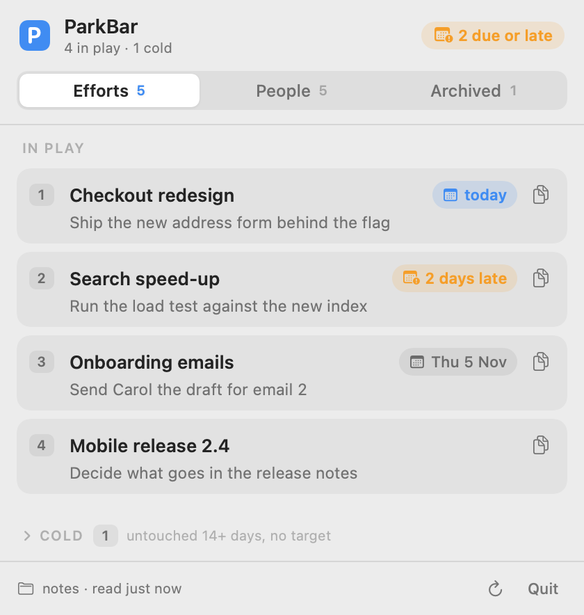
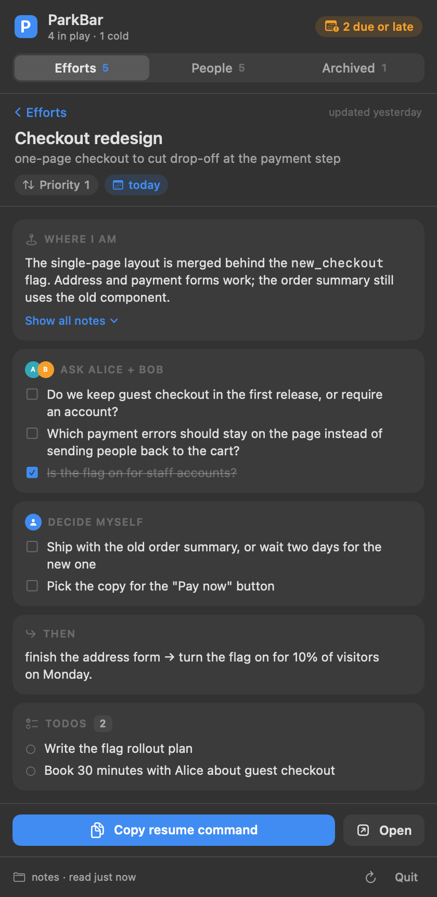
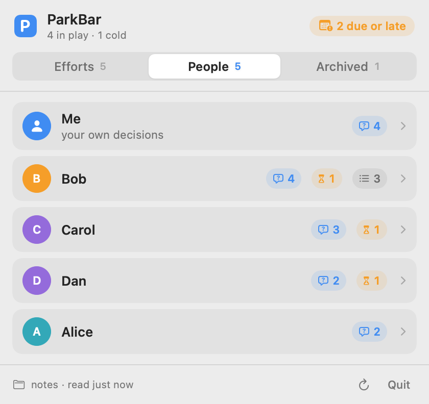

# ParkBar

A menu bar app for work you've parked. It pairs with a `/park` skill for Claude Code, so every
parked session is one click from resuming.

<p>
  
  
  
</p>

You end a working session with `/park`. Claude writes down where you are, what you still have to
ask whom, and what comes next, as one Markdown file per piece of work (an **effort**) in a notes
folder. ParkBar sits in the menu bar and shows those files as a list you can reorder, give dates,
and archive. Click an effort, press **Copy resume command**, paste it in Terminal, and you are back
in the conversation you left.

It reads plain Markdown you can also open in any editor (it works well with Obsidian), and it only
ever changes a few fields and checkboxes in those files.

## Install

You need macOS 14 or later and Xcode 16 (or the Swift 6 command line tools).

```sh
git clone <this repository> parkbar && cd parkbar
scripts/bundle.sh release
open build/ParkBar.app
```

The **P** icon appears in the menu bar, with a count of efforts due today or late. On first start
it looks for notes in `~/Documents/ParkBar`; if there are none it offers **Choose folder…** and
**Try the example notes**. Each try makes a fresh copy of [examples/notes](examples/notes) in
ParkBar's support folder, its dates moved to that day, and shows it with
[examples/config.json](examples/config.json). Your own config is never changed by it, and
**Back to my notes** (or choosing a folder) switches back to your notes and settings at once.

To keep it, copy `build/ParkBar.app` to `/Applications` (or run
`INSTALL_TO=/Applications scripts/bundle.sh release`) and add it to your login items. There is also
a medium Notification Center widget with your top efforts, and a terminal tool,
`.build/release/parkbar-cli` (`parkbar-cli list`, `show <name>`, `people`, `config`, …).

The build is signed ad-hoc, which is enough for the app. The widget is happier with a stable
signature; see [scripts/make-signing-identity.sh](scripts/make-signing-identity.sh).

## The notes folder

```
~/Documents/ParkBar/
├── efforts/
│   ├── Checkout redesign.md     one file per effort; the file name is the effort's name
│   └── Search speed-up.md
├── todo.md                      small actions, some linked to efforts
└── WITH-BOB.md                  optional agenda lists, one per person (see config)
```

An effort file is a block of fields, then your prose:

```markdown
---
about: "one-page checkout to cut drop-off at the payment step"
status: active
priority: 1
target: 2026-10-22
next: "Ship the new address form behind the flag"
updated: 2026-10-21
resume: "claude --resume checkout-redesign"
---
**Where I am:** The single-page layout is merged behind the `new_checkout` flag. Address and
payment forms work; the order summary still uses the old component.

**Clarify with Alice + Bob:**
- [ ] Do we keep guest checkout in the first release, or require an account?
- [x] Is the flag on for staff accounts?

**Decide myself:**
- [ ] Ship with the old order summary, or wait two days for the new one

**Then:** finish the address form → turn the flag on for 10% of visitors on Monday.

refs: design file "Checkout v3" · ticket WEB-412
```

| Field | Meaning | Who writes it |
|---|---|---|
| `about` | One line: what this effort is | `/park`, when it creates the file |
| `status` | `active` or `archived`; missing or empty means active | you, in ParkBar |
| `priority` | Place in your drag order, 1 at the top; missing means the bottom | ParkBar, when you drag |
| `target` | The day you aim to have the next step done; missing means none | you, in ParkBar |
| `next` | One short line: what to do next | `/park`, or you in ParkBar |
| `updated` | The last day the prose changed | `/park` |
| `resume` | The command that reopens the session | `/park` |

An active effort with no target that has not been updated for 14 days goes **cold**: it folds away
under the main list until you give it a target or park new work on it.

**Open** shows an effort's file in Obsidian when the notes folder is inside an Obsidian vault (a
`.obsidian` folder in it or in a folder above it, symlinks followed), and in your default app for
Markdown otherwise, or when Obsidian cannot open it.

### Labels

The prose is yours; ParkBar only looks for a few bold labels at the start of a line:

- `**Where I am:**` — the latest one is shown on the effort.
- `**Clarify with <person>:**` — a checkbox list of questions for that person (or several:
  `Alice + Bob`, `Alice / Bob`, `Alice, Bob and Carol`). They show on that person's page in the
  People tab, and you can tick them in ParkBar.
- `**Decide myself:**` — questions only you can answer; they show under your own name.
- `**Then:**` — the latest one is shown as the plan.
- `refs:` — one line of pointers at the end.

Anything can follow a label in brackets (`**Where I am (22 Oct):**`); in a Clarify label the names
end at a bracket, a dash or a date at the end (`**Clarify with Alice and Bob (by Friday):**` is for Alice and
Bob). The colon may also come after the bold (`**Then**: …`) or be replaced by a dash
(`**Clarify with Bob** — before Friday:`).
Text right after a question label, split by ` · `, becomes questions you can see but not tick.
The full rules, including `todo.md` and agenda lists, are in [docs/FORMAT.md](docs/FORMAT.md).

## Settings

ParkBar works without any settings. To change them, create
`~/Library/Application Support/ParkBar/config.json` (every key is optional):

```json
{
  "notesFolder": "~/Documents/ParkBar",
  "agendaLists": [{ "file": "WITH-BOB.md", "person": "Bob" }],
  "meName": "Me",
  "meLabels": ["Decide myself"],
  "coldAfterDays": 14
}
```

- `notesFolder` — where your notes are. **Choose folder…** writes this for you, keeping your other
  keys. The environment variable `PARKBAR_NOTES` wins over it; while it is set, the panel says so
  and **Choose folder…** explains that it cannot override it (so the app and `/park` never disagree).
- `agendaLists` — running lists of topics for one person each, shown read-only on their page.
- `meName` — the name your own decisions are listed under in the People tab.
- `meLabels` — labels that mean "mine to decide", matched at the start of the label in any case.
- `coldAfterDays` — when a quiet effort with no target goes cold.

Each key is read on its own. A key with the wrong type (`"coldAfterDays": "14"`) or one ParkBar
does not know is ignored, named in the panel and by the CLI, and every other key still applies. A
file that cannot be read or is not valid JSON is shown as a problem and the defaults are used;
**Choose folder…** then refuses to overwrite it and says why.

`parkbar-cli config` prints the settings in effect and where it read them; `--config FILE` reads
another file instead.

`PARKBAR_SUPPORT` moves the support folder (config, pending writes, recovery) elsewhere, for
testing. With it set, the app also leaves the real widget alone: its snapshot goes to
`$PARKBAR_SUPPORT/widget/` instead.

If `--config FILE` cannot be used (missing, unreadable, not valid JSON, or a bad `notesFolder`),
the CLI refuses every command that changes notes unless `--notes` names the folder, so a typo never
sends a write to your default folder; commands that only read go on with a warning.

To try the app or the CLI on the examples without changing the tracked files or your own setup,
build first and work on a copy:

```sh
swift build
TRY=$(mktemp -d) && cp -R examples/notes "$TRY/notes" && cp examples/config.json "$TRY/config.json"
PARKBAR_SUPPORT="$TRY" .build/debug/parkbar-cli --notes "$TRY/notes" --config "$TRY/config.json" list
PARKBAR_SUPPORT="$TRY" PARKBAR_NOTES="$TRY/notes" .build/debug/ParkBar
```

## The /park skill for Claude Code

This repository is also a Claude Code plugin marketplace with one plugin, `park`. From a Claude
Code session:

```
/plugin marketplace add /path/to/your/clone/of/parkbar
/plugin install park@parkbar
```

Then say "park this" or run `/park` at the end of a session. The skill finds your notes folder the
same way ParkBar does (`PARKBAR_NOTES`, then `notesFolder` in the config, then
`~/Documents/ParkBar`) and writes the resume command as `claude --resume <this session's id>`. If
you start sessions through your own wrapper script, change that command prefix in the skill; named
sessions (`claude -n <name>`, then `claude --resume <name>`) work too.

What `/park` writes, and nothing else:

- **A new effort**: `efforts/<Effort name>.md` with `about`, `next`, `updated` and `resume`, then the
  prose. It leaves out `status`, `priority` and `target`: a new effort is active, at the bottom of
  your order, with no target.
- **An existing effort**: `next`, `updated` and `resume` (a field's whole value, replaced by one
  line), new prose blocks added at the end, and ticks on questions the session answered. It sets
  `status: active` only when you pick an archived effort up again; it never sets priority or target.
- **`todo.md`**: new lines under `## Next` and `## Waiting`, linked to the effort, and ticks on
  todos the session finished.
- **`efforts/` and `todo.md` themselves**, if they do not exist yet.

It never rewords or deletes what is already there, and never puts secrets in your notes. Read it in
[plugins/park/skills/park/SKILL.md](plugins/park/skills/park/SKILL.md).

## What ParkBar may write, and how it stays safe

ParkBar reads everything in the notes folder but writes only this, and only to regular `.md` files
directly inside `efforts/`:

- the value of `priority`, `target`, `next` or `status` in the fields block. Setting a field replaces
  its whole value with one `key: value` line: the key's line plus any lines that belong to it (an
  indented `|` or `>` block, or list items under the key). A missing field is added as one new line
  just before the closing `---`;
- the `[ ]` / `[x]` of one question checkbox.

It never changes your prose, `todo.md` or agenda lists, never renames or deletes a note, and every
other line is carried over byte for byte: comments, other fields, lists under other keys. An effort
entry that is a symlink to anything other than an effort file (the todo file, an agenda list, a file
in another folder) is shown but never written; ParkBar says why instead.

Every write is checked, so it cannot overwrite something you changed meanwhile:

1. The file must still have the content ParkBar showed you (it compares a hash). If not, nothing is
   written and the panel says the file changed on disk.
2. The new version is written to a pending file in ParkBar's support folder, then swapped in with
   one atomic rename: the old version comes out where the new one was.
3. ParkBar checks that what came out is exactly what it read. If a save from another app slipped in
   between, it swaps back and tells you the file changed. If even that cannot be proven safe, the
   other version is kept in `~/Library/Application Support/ParkBar/recovery/` and the panel says where.
4. An edit touching several files (a drag renumbers priorities) puts back the files it already wrote
   if a later one fails.
5. If ParkBar is killed in the middle of a write, the next start finds the leftover and keeps it in
   `recovery/`, with a notice.

ParkBar refuses to write to a disk that cannot swap files atomically, or when its support folder is on
a different disk from your notes.

Two limits remain, by design:

- **An app that keeps a file open across the swap can still lose its write.** If an editor opened the
  note before the swap and writes through that same open file afterwards, the write lands in the old
  version, which ParkBar then removes. Editors that save by writing a new file, as most do, are safe.
- **Two other saves around one ParkBar write keep both versions, one of them in recovery.** If the
  note is saved once just before ParkBar's swap and once just after it, ParkBar cannot merge them.
  The note keeps the first save; the second goes to `recovery/` and the panel names the file. Nothing
  is lost, but you merge the two by hand.

## More

- [docs/FORMAT.md](docs/FORMAT.md) — the notes format in full.
- [docs/DESIGN.md](docs/DESIGN.md) — how it is built, and why.
- [GLOSSARY.md](GLOSSARY.md) — the words this project uses.
- [CONTRIBUTING.md](CONTRIBUTING.md) — build, test, and the one rule.

MIT licensed; see [LICENSE](LICENSE).
